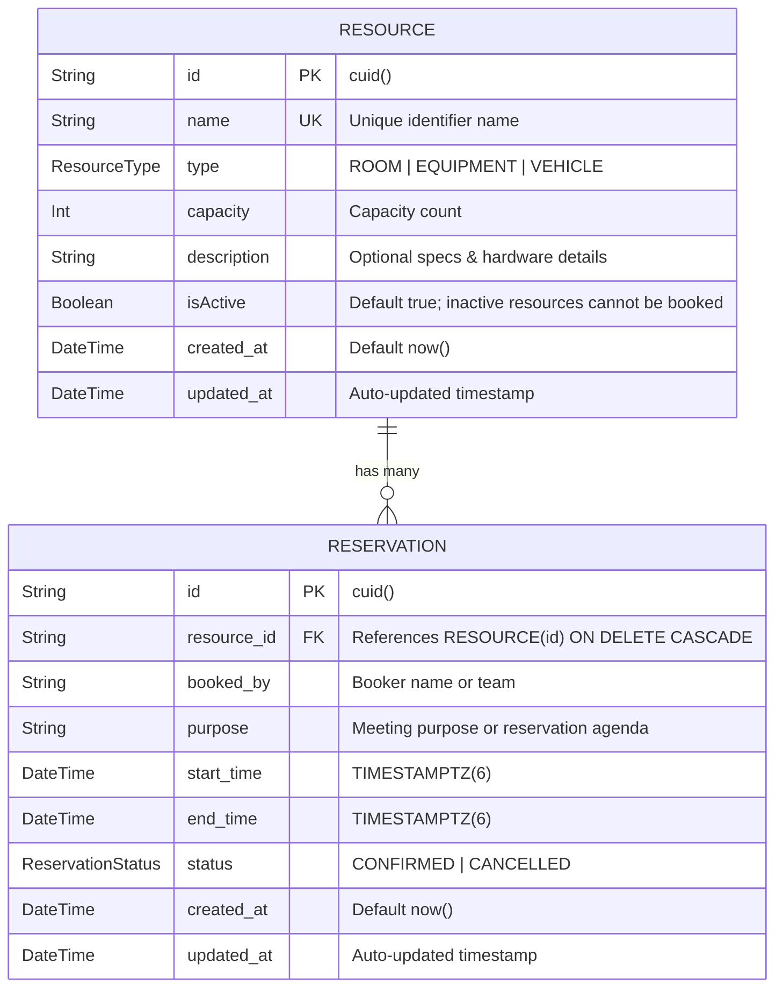

# Entity Relationship Diagram (ERD)

This document visualizes the database schema for the **Resource Reservation Management System**, implemented using PostgreSQL and Prisma ORM.

## Mermaid ER Diagram



---

## Constraints & Integrity Rules

### 1. PostgreSQL Exclusion Constraint (GiST)
```sql
CREATE EXTENSION IF NOT EXISTS btree_gist;

ALTER TABLE "reservations"
ADD CONSTRAINT "no_overlapping_confirmed_reservations"
EXCLUDE USING gist (
  "resource_id" WITH =,
  tstzrange("start_time", "end_time", '[)') WITH &&
)
WHERE ("status" = 'CONFIRMED');
```
* **Guarantee**: Prevents any two `CONFIRMED` reservations for the same `resource_id` from having intersecting time ranges (`[)` closed-open interval).
* **Concurrency**: Handled directly in PostgreSQL kernel using GiST index trees, completely eliminating double-booking race conditions across distributed serverless nodes.
* **Cancelled Bookings**: The partial index clause `WHERE (status = 'CONFIRMED')` guarantees that cancelled bookings release their slot immediately.

### 2. Check Constraint
```sql
ALTER TABLE "reservations" 
ADD CONSTRAINT "check_end_time_after_start_time" 
CHECK ("end_time" > "start_time");
```
* **Guarantee**: Enforces that `end_time` is strictly after `start_time` at database storage level.

### 3. Indexes
- `resources_name_key` (Unique index on `resources.name`)
- `reservations_resource_id_start_time_end_time_idx` (Composite B-Tree index on `(resource_id, start_time, end_time)`)
- GiST exclusion index on `(resource_id, tstzrange(start_time, end_time, '[)')) WHERE (status = 'CONFIRMED')`
